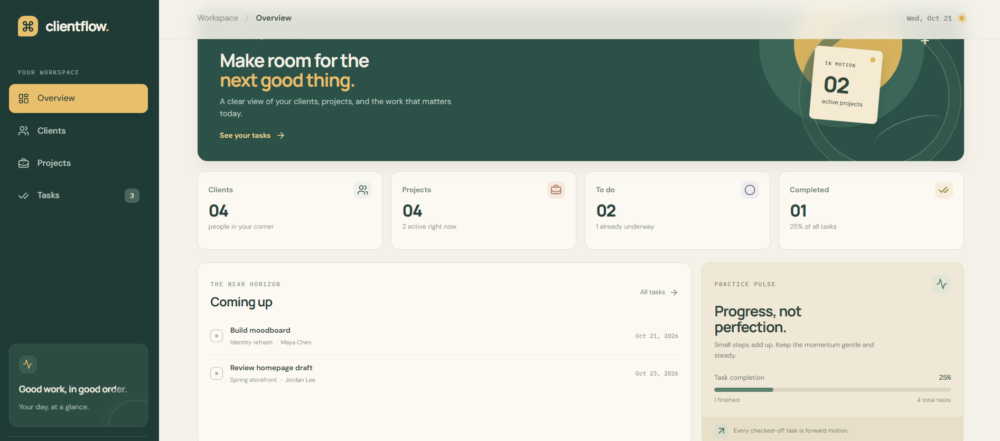

# ClientFlow Manager

A full-stack web application designed to help freelancers manage their clients, projects, and tasks in one organized workspace.

## Tech Stack

- Frontend: React, TypeScript, Vite
- Backend: Node.js, Express
- Database: PostgreSQL, Drizzle ORM
- Authentication: Clerk
- Testing: Vitest, Supertest
- Development Environment: Replit
- Version Control: Git and GitHub

## Features

- Responsive dashboard
- Client management (Create, Read, Update, Delete)
- Project management and client relationships
- Task management with To Do, In Progress, and Done statuses
- Secure sign-up, sign-in, and sign-out
- Protected API endpoints
- User-specific workspaces
- Database persistence
- 
- ## Application Screenshots

### Dashboard

## Security

ClientFlow uses Clerk authentication and server-side authorization checks to protect user data.

- Private API routes require authentication.
- Clients, projects, and tasks are scoped to their owners.
- Cross-user updates and deletions are restricted.
- Users cannot attach projects or tasks to another user's records.

## Testing

The application has been tested for:

- Client, project, and task creation
- Data persistence after page refresh
- Authentication and logout behavior
- Unauthorized API access
- Cross-user data isolation

The focused API authorization suite passed all 3 tests using mocked authentication identities and isolated test fixtures.

## Project Status

**Status: Development / Portfolio Project**

Core functionality and basic authentication are implemented and tested.

The application has not yet been publicly deployed. Additional deployment, configuration, and security checks are recommended before production use.

## Development Notes

This project uses Replit-managed services during development. Authentication credentials, database connection strings, and other secrets must be configured securely and must not be committed to Git.

## Developer

**Mohammad Khattab**

Computer Engineering Student | Laravel & Full-Stack Developer

GitHub: https://github.com/m7mdkh2003
